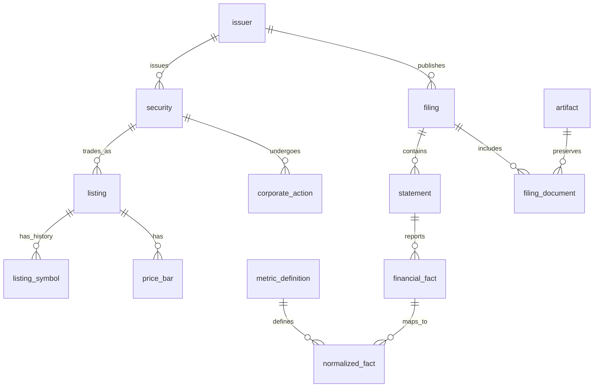

# Japanese and US equities database

> **Status (2026-10-31):** the import-based library of this proposal (ADR-0041) was replaced by automatic annual-statement sync from SEC EDGAR and EDINET ([ADR-0048](../../adr/0048-financial-statements-synced-from-sec-and-edinet.md), [EQUITIES_DATABASE.md](equities.md)). This document is kept as the broader roadmap (prices, corporate actions, guidance, TTM); its import sections are historical.

Status: design baseline, 2026-10-29. The normalized owner-import library is now implemented; its exact supported scope and remaining provider/calculation phases are documented in [EQUITIES_DATABASE.md](equities.md).

## Purpose and scope

Build a source-traceable database for researching Japanese and US listed equities: financial statements, segments, prices, dividends, corporate actions, issuer guidance and valuation metrics. It must answer both “what is the latest reported value?” and “what information was available at this historical time?” without erasing earlier disclosures.

Start with ordinary/common shares and ADRs, annual and interim statements, and daily prices. Preserve multiple share classes, delisted securities, foreign issuers and non-December fiscal years. Preferred shares, REITs, ETFs, tick data, analyst consensus, ownership and news are separate later extensions. A listing in Japan or the US does not imply the issuer's domicile or accounting standard. Initial directory coverage is narrower than the intended database: ADR-0034 currently excludes several Japanese instrument categories and exchanges.

## Storage decision

Target the existing single-owner local SQLite deployment first; retain the SQLite/D1 relational adapter seam for the optional Workers deployment. This proposal does not introduce a shared multi-owner catalog. Keep raw XBRL/iXBRL, PDFs, HTML and provider responses in a content-addressed artifact store: local files first, R2 when needed. Database rows contain hashes, locators and rights metadata. The runner fetches and parses external data; the API validates bounded normalized results and commits them under its existing lease fencing. Remote D1 enablement requires its own measured storage, write and transaction budgets; local capacity does not establish remote suitability.

Do not put every raw XBRL fact for the entire two-market universe into the application's D1 database initially. Download the security directory broadly; ingest statements for requested/watchlisted issuers, with explicit coverage metadata. Start with a reviewed set of normalized metrics and retain source documents for deeper extraction. The same logical model can later move to a dedicated financial-data database behind the port when measured size or query costs justify it. PostgreSQL for concurrent writes and analytical columnar exports are possible later choices, not dependencies of this proposal.

This extends ADR-0004's immutable JSON research records with a relational market-data catalog. Existing `research_records`, Evidence, datasets and chart provenance remain research snapshots. They reference stable financial fact IDs; they do not become the authoritative financial ledger. The current `stock_directory` remains a replaceable search projection, not the source of historical identities.

## Source record update timestamp

Specified once for every source-backed record in [database conventions §11](../conventions.md#11-source-record-update-timestamp) (format, source of the value, pairing with the source identity, independence from other times, immutability), and implemented by migrations 0015 (`equity_source_document`) and 0016 (`metal_observation`). It replaced this design's earlier blanket `updated_at TEXT NOT NULL` proposal.

## Identity model

An **issuer** is the reporting legal entity. A **security** is a share class or depositary receipt. A **listing** is that instrument on a particular venue. A ticker or Japanese securities code is an identifier with a validity interval, never a primary key. An ADR points to its underlying security with a dated depositary ratio; never copy the ADR issuer's financial statements into another company or confuse ADR EPS with ordinary-share EPS.

## Schema conventions

The following is a logical relational schema, not an executable migration. Every table has `owner_id` as the first primary-key and foreign-key component, matching the existing app. `PK(id)` below means `PRIMARY KEY(owner_id, id)`. A reference includes `owner_id`; cross-owner references are rejected by composite foreign keys and authorization checks. Natural uniqueness listed below also includes `owner_id`.

IDs are stable opaque strings. Dates are validated `YYYY-MM-DD`; instants are fixed-width UTC ISO-8601 with milliseconds. Preserve the source's original local timestamp and time zone separately. Effective intervals use `[valid_from, valid_to)`; a null end is open. Unknown dates use explicit null plus a reason; they are not silently replaced with retrieval time. The ingest boundary validates calendars, decimals, enums, JSON structure, foreign-key consistency and nonoverlapping intervals.

Exact numeric values use canonical decimal text, parsed and calculated with exact decimal/rational arithmetic; no authoritative financial amount uses SQLite `REAL` or a JavaScript `number`. An example is `"1234567.89"`; scientific notation, leading plus signs and thousands separators are rejected at the normalized boundary. Remove redundant leading/trailing zeros, omit a redundant decimal point, and canonicalize every signed zero to `"0"`. Normalized values allow at most 100 significant digits and 30 fractional digits; larger source values remain in raw facts with an explicit normalization-range failure. TypeScript and Rust use compatible arbitrary-precision coefficients, checked at this boundary. Preserve original lexical value, scale, decimals/precision and nil state for reported facts. A display float may be derived only after range/precision checks. Dates, quantities, currency, per-share basis and accounting basis travel with every number.

Decimal text is never compared lexicographically or cast to `REAL` for exact screens. Current-screen projections carry a metric-specific scaled signed 64-bit integer sort value and declared scale, with outward-rounded filter bounds and exact post-filtering. Overflow returns an explicit unsupported projection state and uses a bounded exact-decimal runner query; it never silently drops an issuer. Exact ranking resolves projection ties by the original decimals. An implementation must test negative values, sub-scale thresholds, overflow and ties before enabling screening for a metric.

### Companies, securities and listings

| Table | Key and important columns | Constraints / purpose |
| --- | --- | --- |
| `equity_issuer` | PK(`issuer_id`); legal name, local name, domicile country, created_at | Reporting entity; domicile independent of listing market. Names here are current display projections. |
| `issuer_identifier` | PK(`identifier_id`); issuer_id, scheme, value, valid_from/to, known_at, source_document_id | CIK, EDINET code, LEI, Japan corporate number. Store as strings. No overlapping assignment of a scheme/value to different issuers; retain identifier unifications and source corrections. |
| `issuer_profile_version` | PK(`profile_version_id`); issuer_id, names, sector scheme/code, fiscal-year-end label, effective_from/to, known_at, source_document_id | Append-only historical profile; fiscal-year-end is a label, not a rule for reconstructing past periods. |
| `equity_security` | PK(`security_id`); issuer_id, instrument_type, share_class, created_at | Stable instrument identity; common, ordinary or ADR initially. |
| `security_identifier` | PK(`identifier_id`); security_id, scheme, value, valid_from/to, known_at, source_document_id | ISIN and other permitted identifiers. Same temporal uniqueness rule as issuer identifiers. |
| `equity_listing` | PK(`listing_id`); security_id, venue_mic, market_country, trading_currency, exchange_timezone, listed_on, delisted_on, source_document_id | One instrument/venue listing episode. Exchange segment, trading lot and status changes are dated profile versions, not new securities. |
| `listing_profile_version` | PK(`listing_profile_id`); listing_id, segment, lot_size_decimal, status, effective_from/to, known_at, source_document_id | Preserve transfers between TSE segments and historical trading units. |
| `listing_symbol` | PK(`symbol_id`); listing_id, scheme, symbol, valid_from/to, known_at, source_document_id | No overlapping symbol assignment within venue and scheme; punctuation retained; JP codes are text, including letters. |
| `security_relation` | PK(`relation_id`); from_security_id, to_security_id, relation_type, ratio_numerator/denominator, effective_from/to, known_at, source_document_id | ADR-to-ordinary relation and dated ratio. Positive exact ratios; reject cycles for underlying links. |

Issuer resolution uses official identifiers and documented evidence. Matching company names or dividing a Japanese five-character code is not sufficient. Ambiguous matches enter a resolution queue; do not merge automatically. Mergers preserve predecessor and successor IDs. Historical search excludes neither delisted issuers nor former symbols.

### Source documents and ingestion

| Table | Key and important columns | Constraints / purpose |
| --- | --- | --- |
| `data_source` | PK(`source_id`); publisher, provider, source_kind, terms_url, rights_policy_version, retention_policy, checked_at | Source identity and reviewed permissions. Secrets live only in runner configuration. |
| `source_document` | PK(`source_document_id`); source_id, external_id, canonical_url, document_kind | Unique `(source_id, external_id)`; URL alone is not a version identifier. Shared provenance target for directory, filing and market records. |
| `artifact` | PK(`artifact_id`); sha256, byte_length, mime_type, storage_locator, retention_until, rights_policy_version | Unique content hash per owner; reject different bytes for an existing hash. An allowed metadata-only source may have no retained artifact. |
| `source_retrieval` | PK(`retrieval_id`); source_document_id, retrieved_at, artifact_id nullable, HTTP status, ETag, Last-Modified, failure_code, provider_published_at, timestamp_precision | Each attempt is recorded, including failures; unchanged retrieval reuses the artifact. URLs stored without API-key query parameters. |
| `ingest_run` | PK(`ingest_id`); source_id, research_run_id, lease_generation, parser_version, schema_version, started_at, completed_at, version, expected_chunk_count, expected_counts_json, ordered_chunk_digest, state, upstream_status, failure_code | Explicit queued/running/staged/committed/failed state; `completed_at` is server commit time. Stale lease writes and completions rejected. |
| `ingest_item` | PK(`ingest_item_id`); ingest_id, source_document_id, retrieval_id, artifact_hash, parser_version, target_partition, status, diagnostic_code | Partial unique index on `(source_document_id, artifact_hash, parser_version, target_partition)` WHERE status = 'committed'. Failed attempts do not reserve the key. Changed bytes or parser version produce a new parse. |
| `ingest_chunk` | PK(`ingest_id`, `chunk_no`); content_hash, per_table_counts_json, payload_bytes, lease_generation | Exact replay is a no-op; the same chunk number with different bytes is rejected. Expected chunks and counts are sealed before commit. |
| `coverage` | PK(`coverage_id`); issuer_id or listing_id, source_id, dataset_kind, requested_from/to, covered_from/to, status, checked_at, failure_code | Exactly one target; partial/not_requested/not_available/failed/complete are distinct. A covered range means inspected, not “every fact exists.” Internal holes are separate interval rows. |

### Filings and financial statements

| Table | Key and important columns | Constraints / purpose |
| --- | --- | --- |
| `equity_filing` | PK(`filing_id`); issuer_id, source_id, external_filing_id, form_code, disclosure_kind, reporting_period_end, submitted_at, published_at, public_available_at, availability_precision, availability_basis, first_seen_at, amendment_of_filing_id nullable | Unique `(source_id, external_filing_id)`. SEC accession and EDINET document ID remain strings. Amendment link must reference same issuer; amendments are new filings. TDnet earnings releases are distinct from statutory reports. |
| `filing_document` | PK(`filing_document_id`); filing_id, source_document_id, retrieval_id, document_role, language, artifact_id nullable | Annual report, primary iXBRL, instance, taxonomy/linkbases, notes and PDF. Parent/child ownership and retrieval-document agreement validated. |
| `financial_statement` | PK(`statement_id`); filing_id, statement_kind, accounting_standard, accounting_standard_version, scope, reporting_currency, fiscal_year_label, period_kind, period_start nullable, period_end, audited_status | Income/balance/cash-flow/equity/notes; consolidated vs separate. Explicit annual, half-year, quarter, YTD, transition or instant periods. Natural uniqueness includes every basis/period field, with null handled explicitly. |
| `xbrl_concept` | PK(`concept_id`); taxonomy_namespace_uri, taxonomy_version, local_name, datatype, period_type, balance, label_en, label_ja | Unique namespace/version/local name. Store filer extensions, not just standard US GAAP/IFRS/J-GAAP concepts. Prefix alone is not identity. |
| `fact_context` | PK(`context_id`); filing_id, artifact_id, source_context_id, reporting_entity_scheme/value, period_type, period_start nullable, period_end, scope, dimensions_canonical_json, dimensions_hash, scenario_canonical_json | Unique document/context ID. Includes explicit and typed dimensions, segment/geography/product members and other relevant context content. Canonicalizer version recorded. Hash collisions checked against full content. |
| `fact_unit` | PK(`unit_id`); canonical_measures_json, canonical_hash | Canonical namespace-qualified numerator and denominator measures; USD, JPY, shares, USD/share and pure are different units. |
| `source_fact_occurrence` | PK(`occurrence_id`); artifact_id, fact_locator | Unique `(artifact_id, fact_locator)`; stable identity of a fact occurrence in immutable source bytes, independent of parser version. |
| `parse_run` | PK(`parse_id`); filing_document_id, artifact_id, parser_version, ingest_id, completed_at | Immutable parser execution. |
| `parse_fact` | PK(`parse_id`, `fact_id`) | Interpretation membership; a parser run may reuse unchanged fact IDs. |
| `parse_activation` | PK(`activation_id`); filing_document_id, parse_id, policy_version, committed_at | Append-only activation events; selection uses the latest eligible activation, not all parses at once. |
| `financial_fact` | PK(`fact_id`); occurrence_id, interpretation_digest, filing_id, filing_document_id, statement_id nullable, context_id, concept_id, unit_id nullable, value_kind, decimal_value nullable, text_value nullable, unavailable_reason nullable, raw_lexical_value, reported_scale, decimals, precision, reported_sign, share_basis_id nullable, ingested_at | Unique `(occurrence_id, interpretation_digest)`. Digest covers the complete interpreted value/context/unit and canonicalizer version. Numeric, text and nil alternatives are exclusive. An unchanged interpretation reuses its ID; a parser correction makes a new interpretation, while saved research pins the earlier ID. Statement assignment is optional. Conflicting occurrences within an active parse remain visible and flagged. |
| `fact_presentation` | PK(`presentation_id`); fact_id, statement_id, role_uri, parent_concept_id nullable, display_order, preferred_label | Retain statement hierarchy/order and multiple presentation roles without duplicating source facts. |
| `metric_definition` | PK(`metric_definition_id`); metric_code, version, statement_kind, period_type, unit_kind, definition, allowed_standards, formula_version nullable | Unique `(metric_code, version)`; immutable definitions, including exact numerator/denominator and missing-value policy. |
| `metric_mapping` | PK(`mapping_id`); concept_id, metric_definition_id, mapping_kind, issuer_id nullable, scope, dimension_policy_json, sign_multiplier, valid_from/to, mapping_version, reviewed_at, committed_at | Versioned reviewed total/component mapping; same-named concepts are not automatically equivalent. Exact taxonomy concepts stay explicit. Reviewed lineage rules can generate new version-specific mappings, never automatically accept an unreviewed taxonomy upgrade. Applicability checks period/unit/standard. Ambiguity fails closed. |
| `normalized_fact` | PK(`normalized_fact_id`); issuer_id, metric_definition_id, filing_id, statement_id nullable, source_fact_id, mapping_id, period_type, period_start nullable, period_end, scope, accounting_standard, unit_id, dimensions_hash, share_basis_id nullable, decimal_value nullable, unavailable_reason nullable, created_at | Source fact and mapping required. Unique `(source_fact_id, mapping_id)`; selected only through an eligible active parse and total mapping. Multiple disclosures remain separate observations. No destructive latest-value upsert. |

Composite foreign keys enforce that fact, context, statement and document belong to the same filing, using parent unique keys `(owner_id, filing_id, child_id)`; filing/issuer and source-concept/mapping consistency use analogous composite keys. `normalized_fact` duplicates basis columns for indexed reads; these must equal source-derived values. Every SQLite connection enables and verifies `PRAGMA foreign_keys=ON`; tests fail if enforcement is off. Normalize nullable fields in natural unique keys with explicit discriminators or `COALESCE` expression indexes, so duplicate instant statements cannot bypass uniqueness.

Boundary validation additionally checks whole staged batches, but is not the concurrency guard. Every identity partition uses a version CAS. Overlap, cycle, mapping-compatibility and cross-row assertions execute in the same transaction as final inserts, using tested aborting triggers/assertions; failures roll back the batch. Inserts follow parent-before-child order, with prior versions created before supersession edges. Committed facts, parses and research-linked inputs use `ON DELETE RESTRICT`. Cycles in derived inputs are prevented by a server-assigned monotonic dependency sequence (inputs precede outputs); security-relation cycles require a bounded transactional graph check under the identity CAS.

Only a `total` mapping may directly supply a normalized total. Component mappings never compete as alternative totals. A later `metric_composition` registry (PK composition_id; metric_definition_id, version, reviewed component definitions, exclusions, precision policy, committed_at) supplies explicit derived sums with typed input links and prevents parent/child double counting. Until a composition is reviewed, report the total unavailable and count unmapped/component-only coverage. Taxonomy upgrades produce explicit mapping-coverage warnings and a review queue.

Initial metric definitions: revenue, cost of sales, gross profit, operating profit, pretax profit, profit attributable to owners, cash, total assets, total liabilities, equity attributable to owners, current/noncurrent debt, operating/investing/financing cash flow, capital expenditure, basic/diluted EPS, weighted-average basic/diluted shares and period-end shares. Banks and insurers need industry-specific metrics; do not force all issuers into a manufacturing template. “Net income” and “equity” must state the attribution basis. Cash-flow capex tags retain reported sign; a separate derived definition may express positive cash outflow.

### Prices, actions, guidance and derived research

| Table | Key and important columns | Constraints / purpose |
| --- | --- | --- |
| `price_bar` | PK(`bar_id`); listing_id, source_id, trading_date, interval, price_basis, currency, OHLC decimal text, volume decimal text nullable, unavailable_reason, published_at, retrieved_at, source_document_id, ingest_id, supersedes_bar_id nullable | Immutable revisions; provider record/version or artifact hash participates in unique ingest key. Start with daily unadjusted bars. Same listing/date across providers is not a duplicate. Require low ≤ open/close ≤ high, nonnegative volume; reject inconsistent currencies. |
| `corporate_action` | PK(`action_id`); security_id, source_id, provider_event_id, action_type, announced_at, ex_date, record_date, payable_date, effective_at, cash_decimal nullable, currency nullable, ratio_numerator/denominator nullable, source_document_id, retrieved_at, supersedes_action_id nullable | Split, reverse split, cash dividend, stock dividend, spinoff, merger, rights issue and cancellation; payload schema depends on type. Revisions and cancellations are new records. Nullable event ID falls back to a documented stable source locator. |
| `fx_observation` | PK(`fx_id`); base_currency, quote_currency, decimal_rate, observed_at, fixing_kind, source_id, source_document_id, retrieved_at | Rate means quote units per one base unit; positive value. No implicit inversion or spot-to-average substitution. Immutable revisions. |
| `guidance_observation` | PK(`guidance_id`); issuer_id, metric_definition_id, target_period_start/end, scope, standard, unit_id, low/base/high decimal nullable, currency nullable, announced_at, retrieved_at, source_document_id, supersedes_guidance_id nullable | Management forecast; forecast/revision/withdrawal state explicit. Analyst consensus is a different later dataset, never stored as actual financial facts. |
| `derived_observation` | PK(`derived_id`); issuer_id, security_id nullable, listing_id nullable, metric_definition_id, formula_version, parameters_json, period_start/end, scope, standard, unit_id, share_basis_id nullable, decimal_value nullable, precision_scale, rounding_mode, unavailable_reason nullable, computed_at, information_cutoff, ingestion_cutoff, dependency_sequence | Quarterly differences, TTM, margins, growth, market cap and valuation ratios. Unique digest of formula, parameters, ordered input identities and cutoffs. Persist saved research/snapshots; ordinary screen computations use bounded caches, not a permanent row per cutoff. |
| `derived_input` | PK(`derived_id`, `ordinal`); one of normalized_fact_id, derived_input_id, price_bar_id, action_id, fx_id, guidance_id; input_role | Exactly one typed FK is non-null; derived_input_id refers to another derived observation, with cycles rejected. Full reproducibility instead of an unchecked polymorphic ID. |
| `research_fact_link` | PK(`link_id`); research_record_id, evidence_id, normalized_fact_id nullable, derived_id nullable | Exactly one fact target; existing research record/evidence must belong to the same owner. Saved research keeps its original inputs. |

Adjusted price series are derived, with action IDs, adjustment convention, calculation version and availability cutoff. Never overwrite raw OHLC. Distinguish split-adjusted prices from dividend-adjusted total return. A split effective after a historical cutoff cannot silently alter a purported point-in-time series. Shares outstanding and weighted-average shares are separate definitions; market cap cannot use weighted-average EPS shares. ADR valuation requires the dated ratio and underlying-share basis. FX conversion preserves original reporting currency and the chosen rate set; balance-sheet closing rates and income-statement period-average rates are separate transformations.

`share_basis` (PK share_basis_id; security_id, description, basis_effective_at, committed_at) and `share_basis_action` (PK share_basis_id/action_id; ordered action reference) record the reported or transformed split basis. Per-share and share-count normalized observations require a known basis or an explicit unknown-basis reason; comparison and valuation reject incompatible/unknown bases. Unit `USD/share` alone is insufficient. Price revision queries use a source-specific revision sequence in addition to preserving supersession links.

## Time, amendments and point-in-time queries

There are three independent axes:

1. **Economic period:** the actual start/end dates or balance-sheet instant.
2. **Public availability:** when the disclosure could have been known, with source and precision. Filing date alone does not establish intraday availability. If only a local date is known, use the next local midnight as a conservative bound and expose the date-only precision; fully unknown availability is excluded from historical screens.
3. **System knowledge:** retrieval, parsing and normalization timestamps. A later backfill may reconstruct public history, but cannot claim the app had already ingested it.

A request specifies `informationCutoff`, optional `ingestionCutoff`, metric-definition version and a versioned selection policy. Two modes are explicit: **public-history reconstruction** (permits later ingestion of a demonstrably earlier public document) and **system replay** (also filters every source and mapping/derived result by what the system had stored at the ingestion cutoff). Identity resolution, profiles and mapping versions also obey the replay cutoff. An LLM extraction created today is not a historical source assertion without the dated source evidence and its extraction version.

Mutable-looking identity/profile validity and availability columns above are projections only. Authoritative corrections are append-only `identity_assertion` rows (PK assertion_id; target kind/id, asserted fields, effective_from/to, supersedes_assertion_id, source_document_id, committed_at) and `filing_availability` rows (PK availability_id; filing_id, available_at, precision, basis, source_document_id, supersedes_availability_id, committed_at). Listed/delisted dates, interval closure, identifier reassignment and publication-time corrections never edit an assertion used in historical replay. System knowledge starts at the server manifest commit, not the earlier retrieval or staging timestamp. For public-history reconstruction, describe whether current corrected historical metadata is used; it cannot be described as an original system replay.

`selection_policy` (PK policy_id; version, immutable rules_json, committed_at) makes source/parse/mapping precedence reproducible. `filing_relation` (PK relation_id; from_filing_id, to_filing_id, relation_kind, affected_periods_metrics_json, comparability_basis_id nullable, source_document_id, public_available_at, committed_at) captures reviewed amendment, replacement and comparative-restatement relationships. `comparability_basis` (PK comparability_basis_id; issuer_id, fiscal_sequence_id, standard/scope/currency/dimensions, share_basis_id, reviewed_vintage_id, source_document_id, committed_at) supplies a concrete compatibility key for derivations. A new vintage requires evidence identifying the comparative periods affected; a filing lineage alone does not prove an unchanged nine-month value. Without compatible reviewed vintages, derivation returns `INCOMPATIBLE_RESTATEMENT_VINTAGE`.

For an issuer/metric/period/basis:

- Filter committed, validated candidates by owner, entity, definition, actual period dates, scope, standard, unit and dimensions. Do not combine consolidated/separate, USD/JPY, actual/forecast, or FY/quarter/YTD observations.
- Filter `public_available_at <= informationCutoff`; system replay additionally filters retrieval/parse/mapping/normalization times. Apply only corrections known by those cutoffs.
- Compare only candidates in the same semantic group, including share basis and eligible parse interpretation. Within a source, use eligible explicit amendment/replacement relationships and later eligible disclosures of that same period. Keep conflicts visible; an amendment lacking a particular metric does not delete the earlier metric. Stable IDs only order semantically equivalent duplicates for display. Conflicting concepts/values never produce a selected total through an ID tie-break; return an unresolved conflict.
- Across sources, a selection policy may prefer statutory filings to preliminary releases, but reports the alternative observations and rationale. A TDnet earnings release and EDINET report are never merged just because their values match.
- Return selected fact ID, filing/document source, basis, publication precision, retrieval time, mapping/definition version, conflict status and coverage status. “Latest” alone is not sufficient provenance.

Historical availability also applies to withdrawals and filing-status changes. Add append-only `filing_status_event` rows (PK event_id; filing_id, active/withdrawn/replaced, effective_at, known_at, source_document_id) and evaluate only eligible events. Never mark an old filing withdrawn retroactively in an earlier historical query. Explicit replacements between different providers are reviewed relationships rather than inferred from similar values.

## Calculation rules

- **Standalone quarter:** use reported quarter facts when available. Otherwise subtract compatible YTD durations from the same fiscal-year sequence; derive Q4 as FY minus nine-month YTD only for the same accounting/scope/currency/unit/dimension basis and a coherent restatement vintage. Never difference balance-sheet instants. Retain both input IDs. If compatibility or required input is absent, return null with a reason.
- **TTM:** four contiguous standalone fiscal quarters, or annual plus current YTD minus comparable prior YTD only when exact boundaries and bases align. Changing fiscal years, 52/53-week calendars and irregular periods are explicit; never approximate a year with four calendar labels.
- **EPS:** weighted-average shares and EPS are not additive. Derive TTM EPS from compatible earnings and an explicitly defined weighted-share method, or mark unavailable. A provider's directly reported trailing EPS is a separate sourced observation. Adjust per-share figures and price to a documented identical share basis.
- **Ratios:** revenue zero makes margin unavailable; zero/negative EPS makes P/E unavailable under its definition. Missing is null plus a code (`NOT_REPORTED`, `INCOMPATIBLE_BASIS`, `AMBIGUOUS_MAPPING`, `MISSING_INPUT`, `ZERO_DENOMINATOR`, `UNVERIFIED_AVAILABILITY`, etc.), never zero.
- **Cross-market comparison:** normalization identifies comparable concepts; it does not make J-GAAP, IFRS and US GAAP accounting identical. Surface standard and scope and allow exclusion. Keep provider-adjusted/non-GAAP measures in separate definitions with reconciliation evidence.
- **Precision:** formula definitions declare output scale (0..30 fractional digits), rounding mode (initially half-even), input-precision propagation and permitted cross-source combinations. Preserve an exact rational intermediate where needed, then round only at the declared output boundary. Derived display precision cannot exceed the coarsest input's reported accuracy; mixed exact-yen and rounded-million-yen differences require an explicit policy and uncertainty flag. Otherwise return `INCOMPATIBLE_PRECISION`. Overflow is explicit. Fiscal-year or accounting transitions mark a series comparability break; growth/TTM cannot cross it without reviewed restated comparable inputs.

Implement calculation and selection algorithms in the pure domain layer. Before shipping them, model the relevant selection/order, period compatibility and arithmetic preconditions in Lean 4, export conformance vectors and test the TypeScript/Rust implementations against those vectors. This design contains no implemented algorithm and claims no completed proof.

## Providers and coverage

| Dataset | Initial source | Boundaries |
| --- | --- | --- |
| US directory / issuer IDs | SEC ticker/exchange and submissions metadata | Starting directory, not proof of all historical listings or all US venues. Preserve CIKs instead of discarding them after search import. |
| US statements | SEC submissions and company facts for discovery; original XBRL/iXBRL filings for dimensions, extensions and statements | Company facts aggregates standard-taxonomy entity-wide facts; it is not a complete segment/extension archive. Archive the specific retrieved response as evidence. |
| JP directory / identities | JPX directory plus EDINET code list | Reconcile securities, EDINET filer IDs and issuer identities explicitly. Current JPX directory does not establish historical coverage. |
| JP statutory statements | EDINET API v2 document lists and downloaded filing packages | Requires API setup and reviewed terms; classify forms from current metadata. Do not promise every quarterly disclosure exists in EDINET. |
| JP timely results / guidance | TDnet and issuer IR | Separate source/disclosure kind from statutory filings. Public TDnet inspection has a limited window; historical bulk access depends on a licensed service. |
| Daily prices, FX, actions | A permitted market-data provider, selected at implementation | SEC/EDINET are not comprehensive daily-price feeds. Record coverage, delay, adjustments, usage and retention permissions. No assumed free exchange feed. |

Sources checked 2026-10-29: [SEC APIs](https://www.sec.gov/search-filings/edgar-application-programming-interfaces), [EDINET current API and taxonomy documents](https://disclosure2dl.edinet-fsa.go.jp/guide/static/disclosure/WEEK0060.html), [EDINET API v2 specification](https://disclosure2dl.edinet-fsa.go.jp/guide/static/disclosure/download/ESE140206.pdf), [JPX securities codes](https://www.jpx.co.jp/english/sicc/securities-code/index.html), [JPX listed company search](https://www.jpx.co.jp/english/listing/co-search/01.html), [TDnet overview](https://www.jpx.co.jp/english/equities/listing/disclosure/tdnet/), [TDnet database service](https://www.jpx.co.jp/english/markets/paid-info-listing/tdnet/03.html). Access and rights must be rechecked before each provider is enabled. No paid provider is automatically subscribed.

## Ingestion, performance and recovery

1. Resolve issuer/listing identifiers from a captured directory document; quarantine ambiguous matches.
2. Discover new documents from submissions/date lists using an overlapping watermark, so a late amendment or withdrawal is not missed. A failed partition never advances the committed watermark.
3. Fetch with host allowlists, bounded response sizes, timeouts, provider pacing and capped exponential-backoff retries. Retain exact upstream 4xx/5xx status alongside the stable application code (ADR-0037). Keep keys out of URLs, logs and artifacts.
4. Hash and store permitted bytes, parse on the runner, validate taxonomy/context/unit and mapping versions, then stage bounded chunks in separate `stg_*` tables keyed by `(owner_id, ingest_id, local_key)`. Live natural unique keys never apply to abandoned staging attempts. Reuse an unchanged document and successful parse; ETag alone does not establish content identity. Every chunk write checks the current lease generation and a staging-state CAS; expired writers cannot add data. Successful parse idempotency is checked again at promotion; an equivalent committed parse returns the existing result.
5. Seal expected ordered chunk hashes and per-table row counts. In one guarded transactional batch, verify exact chunk membership, counts and ordered digest, CAS the identity/data partition version and job lease, promote all rows for the bounded partition in FK order, run cross-row assertions, append parse activation, update coverage and mark the manifest committed with server time. Any mismatch or error aborts the batch. Staging writes are frozen after sealing. Counts alone do not establish semantic validity; checks include required document/context/unit references. No partially promoted statement is visible. A partition is a complete declared extraction scope for one document/parse, not a claim that every raw fact was normalized.
6. Rebuild “current metric” projections after commit; each carries the generation and is served only when that generation matches, otherwise reads fall back to authoritative committed rows. A crash cannot expose stale coverage as current. Projection updates use generation CAS so a slow older rebuild cannot replace a newer result. Failed staging attempts expire; garbage collection deletes only unreferenced staging/artifacts and never a fact or parse pinned by saved research.

Set a measured maximum rows, bytes, statements and bind parameters for an atomic promotion, separately for local SQLite and D1. A document exceeding the verified budget fails with `INGEST_PARTITION_TOO_LARGE`; retain its artifact and mark the extraction coverage incomplete. Narrow the declared metric extraction or use the dedicated history adapter; do not silently split a promised complete statement into visible partial commits. Every final row records its originating committed ingest; deduplicated immutable parent rows can be reused across ingests without transferring ownership to a failed attempt.

Parsing security is an implementation gate: cap compressed and decompressed bytes, entry count, compression ratio, XML depth, fact count, text size, CPU and memory. Disable DTD/external entity resolution and remote taxonomy fetching except through the same approved fetch boundary. Never extract by archive-supplied paths; store owner-scoped hashes under a verified root, prevent symlink/path escapes and verify hashes on read. Treat text blocks as untrusted bounded data in agent prompts and UI; sanitize to text/restricted markup and never render source HTML. Rights classes follow source-to-fact-to-derivation lineage and are checked on display/export/research linkage, including licensed derived values. Artifact deletion respects reference counts and rights/retention rules.

Initial access-path indexes (all start with owner): identifiers by scheme/value; symbols by scheme/symbol/venue; filings by issuer/public_available_at/filing_id; normalized facts by issuer/metric-definition/period_end/scope/standard/unit/dimensions; prices by listing/trading_date/source; actions by security/effective date; coverage by target/source/kind. Add reverse FK indexes where deletes or joins require them. Use measured query plans to avoid redundant indexes and D1 write amplification. Canonical JSON is for source-specific dimensions or parameters, not a substitute for indexed issuer/period/basis columns.

Use a rebuildable historical candidate projection for broad historical screens, carrying `(owner, issuer, metric, period/basis, availability_observation_id, available_at, available_precision, committed_at, fact_id, policy_version, generation)` with an availability-range index. Availability corrections append a candidate version; replay selects the eligible version. Keep the authoritative normalized fact immutable and verify candidate joins against the committed-ingest and eligible-parse indexes with `EXPLAIN QUERY PLAN`. This avoids blindly denormalizing a mutable corrected publication time into historical truth. Define dimension/scenario canonicalization with a named, versioned serialization, canonical QNames and typed-member handling; retain full canonical content beside hashes.

Serve bounded company metric series and cross-sectional current screens from projections; use keyset pagination and parameterized set queries, not one fetch per company. Current projections are suitable only for current selection policy; historical screens use eligible facts or a materialized snapshot keyed by cutoff and policy version. Cache keys include owner, entity, period/basis, cutoff, definition/mapping/policy versions and committed generation; new commit invalidates affected current entries. Immutable source facts need no TTL, while provider discovery freshness follows a documented provider-specific cadence.

Capacity planning is an implementation gate: a scenario of 12,000 issuers × 10 years × 4 periods × 40 metrics is **19.2 million normalized rows before revisions**, plus source facts and indexes, for this single-owner deployment. This is a sizing scenario, not measured coverage or a D1 capacity claim. Measure per-filing facts, contexts, units, presentations, mapping rows, stage writes, index-entry writes, database/index bytes, parsing time and read/write costs on representative US and JP filings before enabling broad history. Configure explicit per-filing write budgets from those measurements and verified deployment limits. Keep the app catalog/projections bounded; move large history behind a repository adapter when it exceeds the deployment's verified budget. Do not silently truncate requested history.

Back up database manifests and artifacts together; verify hashes and replay a restore. Additive migration first, backfill in restartable partitions, compare old/new reads, then enable the feature. `US:AAPL` / `JP:7203` compatibility IDs map to a listing through a dated alias and ambiguity check; they remain valid for existing widgets. New saved research stores the resolved listing ID and alias resolution date; legacy alias-only records require a trusted original date and otherwise show ambiguity rather than attaching to a reused ticker. Do not change current directory/Watchlist contracts or delete `research_records`. Identity ingestion is a separate job/payload and append-only store, not extra fields in the existing replace-all directory completion; measure its serialized bytes independently. Rollback disables new reads/writes and restores a tested database/artifact snapshot if necessary; existing source snapshots remain intact.

## Implementation sequence and acceptance

1. Identity and provenance tables, reviewed migrations and ownership constraints; retain official IDs through a separate identity-ingestion job; introduce read-only listing resolution without changing existing directory contracts.
2. Statutory US/JP ingestion for selected issuers; raw artifacts, exact facts, contexts, units, statement presentation, amendments and coverage. Start with income/balance/cash flow, then notes and segments.
3. Reviewed metric mappings; point-in-time and conflict selection; quarterly/TTM algorithms with Lean models and vectors; bounded statement/metric API.
4. Daily prices/actions/FX with permitted providers; issuer guidance and derived valuation; current screen projections and catalog-to-research evidence links.
5. Broader historical coverage only after rights, storage/performance measurements and restore tests pass.

Required fixtures include a Japanese J-GAAP consolidated/separate issuer, a Japanese IFRS issuer, a US GAAP issuer, a foreign US-listed IFRS issuer, a multi-class issuer/ADR, a delisted/ticker-reused listing and a changed fiscal year. Exercise extension tags, typed dimensions, explicit nil vs zero, values beyond IEEE-754 precision, duplicate/conflicting contexts, nine-month YTD vs quarter, 53-week periods, amendments, withdrawals, split revisions and forecasts. Fail on cross-owner or cross-filing references and conflicting identity intervals.

Query acceptance includes: revenue by issuer/year with source links; three statements with source presentation; geographic/product segments; JP/US comparison with explicit bases; historical screen before/after an amendment with no future information; ADR valuation with ratio; daily unadjusted vs split-adjusted series; retry/reparse idempotency; partial ingest invisibility and stale-lease rejection. Test SQL adapters on both SQLite and Workers D1, query plans and representative-volume budgets. Measure `bun run bench` before/after changing a hot path.

Before shipping, run the actual development launcher and real runner against permitted SEC and EDINET documents in throwaway data directories on test ports, from fresh and upgraded installations, and inspect outputs against the original statements. Capture command, provider configuration (without secrets), outcome and coverage limitations. Run equivalent production validation before release. The present documentation-only proposal has no live ingestion implementation, so no application/network positive-path test is claimed.

## Review record

Claude Code review and finding dispositions are recorded in [equities design review](../reviews/equities-design-review.md). The review is of the design, not a claim that a deployed database or live provider integration has been tested.
