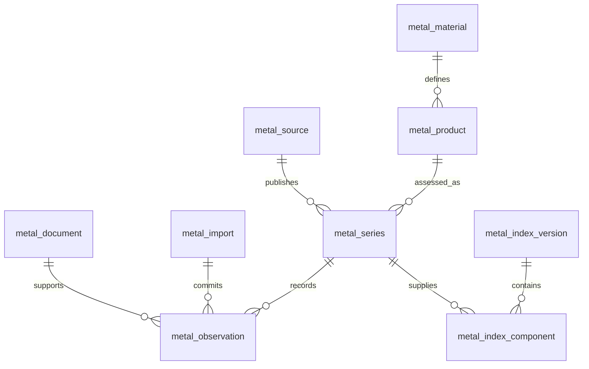

# Metals and minerals price database

Status: full target design, 2026-10-29. The first owner-import and widget-read phase is now implemented; [materials library guide](materials.md) defines its narrower supported scope. The normalized registry, automatic revision selection and provider ingestion below remain proposed.

## Scope

Store prices of physical materials: silver, copper, neodymium, samarium, tungsten, lithium and further metals/minerals. An ETF, mining stock or futures contract cannot substitute for a physical-material series. “Metal index” means the searchable price-series directory initially; a calculated composite benchmark is a separate, explicitly versioned entity.

Group materials under precious metals, base metals, rare earth elements and other critical minerals. Neodymium and samarium belong to rare earth elements; tungsten and lithium belong to other critical minerals. Classification is a discovery aid, never a pricing identity.

A material has no single universal price. Neodymium metal and neodymium oxide, lithium carbonate and lithium hydroxide, and tungsten metal and ammonium paratungstate (APT) require separate products. Grade, purity, assessment location, delivery basis, currency, denominator and methodology distinguish series. Do not silently combine them.

## Storage and conventions

Use the existing local SQLite deployment and relational adapter boundary; retain D1-compatible tables. Start with requested series, bounded imports and daily/monthly observations. Keep licensed raw responses in the artifact store only when retention rights permit. No new database service is necessary. Remote deployment needs measured D1 capacity and transaction limits before enablement.

All tables below are prefixed `metal_`. Every primary key, natural uniqueness constraint and foreign key includes `owner_id`; `PK(id)` abbreviates `PRIMARY KEY(owner_id, id)`. IDs are immutable opaque strings, never provider symbols. Follow [database conventions §4](../conventions.md#4-naming) for column suffixes and [naming conventions](../naming.md) for the library vocabulary and decimal conventions. Exact authoritative amounts are canonical decimal strings; chart numbers are finite, explicitly rounded projections. Dates use validated ISO calendar dates; timestamps use canonical UTC instants, preserving source time zone separately.

## Source record update timestamp

Specified once for every source-backed record in [database conventions §11](../conventions.md#11-source-record-update-timestamp) (format, source of the value, pairing with the source identity, independence from other times, immutability), and implemented by migrations 0015 (`equity_source_document`) and 0016 (`metal_observation`). It replaced this design's earlier blanket `updated_at TEXT NOT NULL` proposal.

## Relationships

## Logical tables

This is a logical schema, not executable SQL. Required fields are non-null unless marked nullable. Application validation complements SQL checks, foreign keys and uniqueness constraints.

| Table | Main columns and constraints |
| --- | --- |
| `metal_material` | `PK(material_id)`, unique `material_code` (e.g. `neodymium`), `chemical_symbol` nullable, `category_code`, `active`. Elements and compounds are distinguished through products; a mixture may have no single chemical symbol. |
| `metal_material_name` | `PK(material_id, language_code, name_kind, name)`, FK material; localized preferred names and aliases. At most one preferred name per material/language, enforced with a partial unique index. |
| `metal_product` | `PK(product_id)`, FK material, unique `product_code`, `form_code` (metal/oxide/carbonate/hydroxide/concentrate/other), `chemical_formula` nullable, `grade_description`, `purity_min_decimal` nullable, `purity_max_decimal` nullable, `purity_basis` nullable, `specification_json`, `specification_sha256`. Unknown purity is explicit; percentages are bounded 0–100 and min ≤ max. Structured specification defines analytes, moisture, particle size and grade where relevant. |
| `metal_source` | `PK(source_id)`, unique `source_code`, `publisher`, `website_url`, `license_reference`, `can_store_raw`, `can_display`, `can_export`, `retention_days` nullable, `attribution_text`. Store credential references only; actual secrets stay in runner environment variables. Default permissions are false pending rights review. |
| `metal_series` | `PK(series_id)`, FK product and source, `provider_series_code`, `definition_version`, `supersedes_series_id` nullable FK series, `region_code`, `delivery_location`, `delivery_basis`, `tax_basis`, `currency_code`, `denominator_unit`, `denominator_quantity_decimal`, `content_basis`, `frequency_code`, `market_timezone`, `methodology_url`, `methodology_sha256`, `assessment_kind`, `active`, `definition_sha256`. Unique `(source_id, provider_series_code, definition_version)`. Denominator quantity > 0. All identity fields immutable; material changes create a new version/series. |
| `metal_document` | `PK(document_id)`, FK source, `source_url`, `published_at` nullable, `retrieved_at`, `content_sha256`, `artifact_locator` nullable, `license_reference`, `retention_expires_at` nullable. A document may retain metadata/hash alone when storage is prohibited. URLs are validated HTTPS and fetched through existing restricted network adapters. |
| `metal_import` | `PK(import_id)`, unique `idempotency_key`, `content_sha256`, unique `commit_sequence`, `committed_at`, `parser_version`, `schema_version`, `record_count`. Successful atomic imports only. A replay with the same key/hash returns the original receipt; a changed payload conflicts. Assign commit sequence in the transaction. |
| `metal_observation` | `PK(observation_id)`, FK series/import/document, `period_start`, `period_end`, `assessment_key`, `source_revision_key`, `published_at` nullable, `availability_basis`, `value_decimal` nullable, `low_decimal` nullable, `high_decimal` nullable, `value_basis`, `unavailable_code` nullable, `supersedes_observation_id` nullable FK observation, `record_sha256`. Unique `(series_id, period_start, period_end, assessment_key, source_revision_key)`. Revisions append; conflicting reuse fails. See invariants below. |
| `metal_refresh_state` | `PK(series_id)`, FK series, `last_attempt_at` nullable, `last_success_at` nullable, `next_attempt_at` nullable, `coverage_start` nullable, `coverage_end` nullable, `failure_code` nullable, `upstream_status` nullable. Mutable operational state; failures never delete observations. Upstream status remains the original numeric HTTP status. Coverage endpoints describe bounds, not gap-free completeness. |

`assessment_key` distinguishes legitimate assessments within a period (e.g. named daily sessions). It cannot be an arbitrary random value used to bypass duplicate detection. Provider adapters map it deterministically. `source_revision_key` is the provider revision ID or a deterministic hash of this observation’s normalized content and its predecessor ID when no revision ID exists. Compare against the current source revision first: an unchanged reread is idempotent, while a genuine source revision, including A→B→A, appends a row. Parser corrections use a new import and explicit revision lineage, preserving the original document and source publication time.

Product specifications are canonicalized and bounded at the boundary. Product changes allocate a new product ID. The ingestion service rejects two IDs for the same canonical specification. Series definition hashes cover every identity field, including product specification hash. Preserve unknown delivery/tax/content bases with explicit `unknown` values; unknown does not compare equal to a known basis for conversion or aggregation.

## Observation invariants and history

- `period_start ≤ period_end`. A daily price uses the same date for both; monthly averages carry their actual reporting month, never a fabricated daily sequence.
- A scalar quote has `value_decimal`, `value_basis = reported`, and no low/high pair. A range quote has both low/high, low ≤ high, and may omit its scalar. A source-reported scalar accompanying a range must lie inside it. A midpoint is calculated separately, labeled derived and tied to its input IDs; it never becomes a reported quote.
- An unavailable row has no scalar or bounds and requires a stable `unavailable_code`; an available row has no unavailable code. Zero is a value, never a missing marker. Validate numeric signs according to the versioned assessment specification rather than a universal price assumption.
- A superseding row belongs to the same series, period and assessment key. Source revision chronology is independent of import order: an archived original can arrive after its correction. Revision links preserve provenance; eligibility and ordering use the rules below. Reject cycles and conflicting lineage transactionally.
- `published_at` is a source publication instant when known. Retrieval and import times are distinct. `availability_basis` is `source-publication` or `first-retrieval`; the latter cannot claim that the data was publicly available before first retrieval.
- A query accepts `ingestionVersion` (owner commit sequence) and optional `availableBefore`. Filter commits and availability first, then choose the eligible revision with greatest effective availability time, provider revision order when supplied, and commit sequence as a deterministic final tie-breaker for each series/period/assessment. Never select the latest row first and filter afterwards. Return the chosen observation IDs and time basis with every value.
- Missing periods remain gaps. Annual, monthly and daily observations retain their frequency. No forward fill or interpolation occurs implicitly.

Enforce structural constraints in SQL where possible. Exact decimal comparisons, canonical JSON hashes and calendar validity are checked at the typed import boundary inside the atomic import workflow. Repository adapters must not expose an unvalidated bypass.

## Initial directory and data sourcing

Seed material/product identities independently of provider availability. A directory entry without an approved feed says `not-configured` and cannot generate a chart of invented observations.

| Material | Candidate products; each becomes a distinct series per source and basis |
| --- | --- |
| Silver | Silver metal spot; preserve troy-ounce basis |
| Copper | Copper cathode/identified global assessment; preserve monthly-average frequency when supplied monthly |
| Neodymium | Neodymium metal; neodymium oxide; NdPr mixed oxide is a separate explicitly named mixture product |
| Samarium | Samarium metal; samarium oxide |
| Tungsten | Tungsten metal; APT; concentrate, distinguished by contained WO3 basis |
| Lithium | Lithium carbonate; lithium hydroxide, preserving battery/technical grade and hydrate specification |

Existing silver (`twelve-data:XAG/USD`) and copper (`fred:PCOPPUSDM`) can be mapped only after their provider definitions and units are verified. Existing generic `market_series` / `market_observations` are presentation caches, not this revision ledger. Do not backfill provenance or grade that old rows do not establish.

SMM publishes [rare-earth oxide assessments](https://www-old.metal.com/Rare-Earth-Oxides) and offers a [historical data API](https://www.metal.com/smm-api). These are candidate sources, not an implemented integration or a guarantee of account entitlement. Provider selection, exact product codes, access, license rights, historical coverage and documented API contracts remain prerequisites. No ETF or stock fallback is allowed.

## Units and derived indexes

Use explicit denominator codes such as `kg-product`, `metric-tonne-product`, `troy-ounce-fine`, `kg-contained-element` and `mtu-WO3`. Currency per unit is not interchangeable with currency per contained element. Unit definitions include exact rational conversion factors and version IDs. Reject conversions with unknown grade, moisture or content basis. Currency conversion requires the FX observation ID, quotation direction, date alignment rule and rounding policy; retain original values.

A future composite uses `metal_index`, immutable `metal_index_version` (methodology, base date/value, rebalance calendar, missing-data rule, calculation version), `metal_index_component` (FK version and series, exact nonnegative weight, effective interval) and `metal_index_value` (version, date, value, input-manifest hash, calculation time, ingestion cutoff). Component weights must sum exactly to one at each effective interval. The input manifest lists observation/FX/conversion IDs and weights and is retained, not just hashed. Prevent overlapping component intervals and look-ahead. Initial methodology should reject missing components; no implicit weight redistribution. Published provider indexes and locally calculated composites are separately labeled. Composite calculation is outside the first phase.

## Queries, indexes and performance

Create indexes matching bounded access paths:

- `metal_observation_by_series_period` on `(owner_id, series_id, period_end DESC, assessment_key, import_id)`.
- `metal_observation_by_import` on `(owner_id, import_id)`; unique natural revision key as above.
- `metal_import_unique_commit_sequence` on `(owner_id, commit_sequence)` (the table’s unique constraint; no duplicate index).
- `metal_series_by_product` on `(owner_id, product_id, active)`; source natural key as above.
- `metal_material_name_by_lookup` on `(owner_id, language_code, normalized_name, material_id)`; add stored, versioned `normalized_name` to the names table for deterministic exact/prefix search.

Queries require owner scope, a bounded series list, date range and keyset pagination. Chart projections retain chosen IDs, basis, units and source; do not fetch raw artifacts for chart reads. Batch series metadata and observations to avoid N+1 requests. Cap import bytes, rows, decimal digits and specification size before writes. Load-test expected daily/monthly histories and inspect `EXPLAIN QUERY PLAN` before adding a current-value projection. No unsupported performance claim is made by this document.

Cache by owner, series definition, range, ingestion cutoff, availability cutoff and projection version. Commit sequences invalidate price projections; source rights changes invalidate display/export authorization immediately. Provider refresh TTL follows frequency and publication schedule, with bounded retries/backoff, timeouts, lease fencing and rate limiting. Source documents shared by multiple series should be fetched once per refresh batch.

## Application boundaries and delivery plan

Contracts: `MetalMaterial`, `MetalProduct`, `MetalSeries`, `MetalObservation`, `MetalImport` and validated schemas in `packages/contracts`. Pure conversion, revision selection and composite logic belong in `packages/domain`; ports/use cases in application; SQLite/D1 and provider adapters outside the core. No `any` types. API routes under `/api/v1/metals` expose materials, series, bounded observations and atomic imports. Contracts carry exact decimals and provenance; charts receive a bounded numeric projection with explicit rounding. English/Japanese UI wording lives in message catalogs.

The existing market provider union accepts FRED and Twelve Data only. Adding `metal:<series_id>` requires an explicit contracts/runner/widget integration and regenerated Rust conformance vectors, not merely catalog entries. Keep existing persisted widget IDs valid; add a resolver rather than rewriting owner dashboards. Detail views show product, grade, region, delivery/tax basis, units, source, frequency, assessment period and freshness. Provider errors retain their status through API responses; partial refresh failures remain visible alongside last successful data.

1. Approve product/basis definitions and source access; implement catalog and normalized owner import with migration and contract tests.
2. Add source adapters with real-network positive-path validation using throwaway development state; exercise fresh and upgraded installations. Extend widget series resolution and rich provenance before exposing these series.
3. Add exact unit/FX conversion and only then optional composite indexes.

Each algorithm introduced in the domain requires a Lean 4 model/proof plus exported TypeScript conformance vectors: revision eligibility/selection, exact conversions and composite weights/calculation. This document introduces no executable algorithm or proof claim. Validate migrations on fresh and upgraded databases; test owner isolation, duplicate/replayed imports, changed-payload conflicts, rollback, revisions, missing publication times, ranges, gaps, decimal limits, unknown units, rights restrictions and unchanged external status propagation. Benchmark affected hot paths before/after implementation.

No schema migration, live ingestion, UI flow or real-environment test was run for this design-only change. Outstanding decisions: provider contracts and credentials, initial grades/regions, retention rights, import limits, measured capacity budgets and whether composite indexes are needed.

## Claude Code review resolutions

Independent review completed on 2026-10-29. The following refinements are normative parts of this proposal and take precedence over abbreviated table entries above:

- Physical reference prices may be exchange cash settlements, benchmark auctions, price-reporting-agency assessments, indicative OTC spot quotes, statistical averages or premium differentials. These are the closed `assessment_kind` values. Futures/forwards, ETF NAV and equities remain excluded. A premium differential is charted with its own label and is never presented as an outright metal price.
- Replace the single product/material relationship with `metal_product_component`, PK `(owner_id, product_id, material_id, content_basis)`, composite product/material FKs and bounded minimum/maximum percentage decimals. Products may have multiple elements. Preserve total rare-earth-oxide purity and individual oxide share of TREO as distinct specification measures. Material category is only a primary navigation group; dated jurisdictional classifications use a separate `metal_material_classification` table with scheme/version, material, category and effective interval.
- Add `metal_unit_definition`, PK `(owner_id, unit_id, definition_version)`, with dimension, numerator/denominator rational factors and exact content/moisture basis. Series references the versioned unit. Fine troy ounce, dry metric tonne and dry metric tonne unit are distinct from gross product mass; no generic mass conversion crosses content bases.
- Add `source_id` and `commit_sequence` to observations. Composite foreign keys enforce that the document and series have that source and the import has that commit sequence. A same-series/period/assessment composite FK constrains supersession, with a no-self-reference check and immutable update/delete triggers. Do not enforce commit-order lineage or a single root: archived out-of-order revisions must remain importable. Validate acyclic provider chronology in the atomic service and reject ambiguous revisions instead of silently selecting one.
- `availability_basis = source-publication` requires non-null `published_at`. Otherwise effective availability is the document’s first retrieval instant, retained immutably. Source chronology and knowledge/commit chronology remain separate. Provider revisions sharing a publication instant require an explicit revision order; unresolved order is an import conflict. An absent predecessor can remain unlinked until supporting history arrives; immutable rows need no rewritten provenance to support temporal selection.
- Complete `value_basis` as `reported`, `range-only`, `unavailable`. Initial charts show the range as a band; a scalar-only renderer shows unavailable with a reason. An explicitly requested midpoint is a derived projection with its formula and inputs, never a reported quote.
- Sources distinguish original publisher from distributor using nullable `original_source_id` with owner-scoped FK. Display/export/storage permission is the intersection of all applicable licenses; retain attribution to both. Unknown permissions deny use.
- Imports add bounded nonnegative `record_count`, `coverage_note` and `payload_json` when rights permit. If payload retention is prohibited, retain the receipt/hash and mark download/reimport unavailable. Owner imports and runner ingestion are separate commands; runner manifests add `runner_job_id` and `lease_generation` and commit only in the existing lease-fenced batch. They cannot use the owner-import path to bypass fencing.
- Reference-data installation is an explicit owner import from a reviewed versioned example catalog, never migration-time writes to live owners. Name rows include `normalized_name` and `fold_version` using the existing directory folding conventions. Prefix lookup is initial scope; substring search is not promised.
- Keep the series-version ID pinned in a widget so a methodology change cannot silently alter its meaning. A replacement requires an explicit owner action; superseded series remain readable and show their status. A stable lineage can group related versions for discovery without auto-switching.
- Adopt existing exact decimal and temporal-eligibility primitives/Lean models where compatible. Introduce an explicit `metal_fx_observation` ledger with currency pair, exact rate, source document, publication/retrieval times and import sequence before FX conversion; do not depend on an unimplemented equities FX table.
- Prefer `WITHOUT ROWID` for composite-key tables where measured useful. The observation access index uses commit sequence rather than opaque import ID. Defer the by-import index until an actual query needs it; measure D1 row-write amplification. `metal_refresh_state` owns operational metal ingestion only; generic widget cache freshness remains a projection.

Naming extension: `metal_` SQL entities and `Metal`/`metal` contracts follow the structural conventions of the equities naming guide; its equity-specific entity prefix does not apply. An implementation ADR and a formal naming-guide amendment are required with the migration. This proposed document itself creates no runtime namespace.
